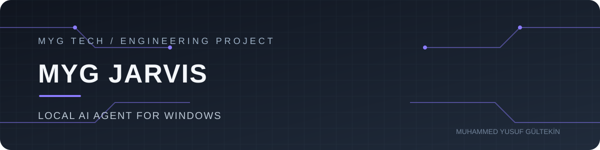

<div align="center">
  <a href="https://myusufgultekin.web.app/"></a>
  <p>  </p>
  <p><a href="https://myusufgultekin.web.app/">MYG TECH</a> · <a href="https://github.com/nicewo">GitHub Profile</a></p>
</div>

---

# MyG JARVIS

**Your local AI agent for Windows.**

MyG JARVIS is a modular desktop assistant designed to connect AI models with controlled local computer operations.

The goal is to build an assistant that can understand natural-language instructions, plan tasks, work with development tools, execute bounded operations, inspect results, and recover from errors.

## Vision

- Multi-provider AI: OpenAI, Anthropic Claude, and Google Gemini
- Native desktop application using C# and WPF
- .NET 10 and modern Windows development
- PowerShell-based local task execution
- Autonomous task planning and result verification
- File, Git, build, and test workflows
- Persistent task history and configurable security policies
- Future voice interaction and extensible tools

## Architecture

```text
MyG.JARVIS/
├── MyG.JARVIS.slnx
├── MyG.JARVIS.App/
├── MyG.JARVIS.Core/
├── MyG.JARVIS.Agents/
├── MyG.JARVIS.Providers/
├── MyG.JARVIS.LocalAgent/
├── MyG.JARVIS.Infrastructure/
├── MyG.JARVIS.Tests/
├── README.md
├── LICENSE
└── .gitignore
```

The architecture represents the planned structure. Additional projects will be introduced incrementally as implementation progresses.

## Technology Stack

- C#
- .NET 10
- WPF
- PowerShell
- Git and GitHub

## Development Status

**Phase 1 — Foundation**

The initial milestone is a working desktop interface with text-based interaction. AI integrations, controlled local execution, and autonomous task workflows will follow in separate stages.

## Security

- Least-privilege execution
- Restricted working directories
- Validated tool requests
- Process timeouts and cancellation
- Auditable operation logs
- No unrestricted execution of model-generated commands
- API credentials excluded from source control

## Requirements

- Windows 10 or Windows 11
- .NET 10 SDK
- Visual Studio 2026 with the .NET desktop development workload

## Build

```powershell
dotnet build .\MyG.JARVIS.slnx
```

## Run

```powershell
dotnet run --project .\MyG.JARVIS.App\MyG.JARVIS.App.csproj
```

## License

This project is licensed under the MIT License. See [LICENSE](LICENSE).

---

**MyGTech · MyG JARVIS**
